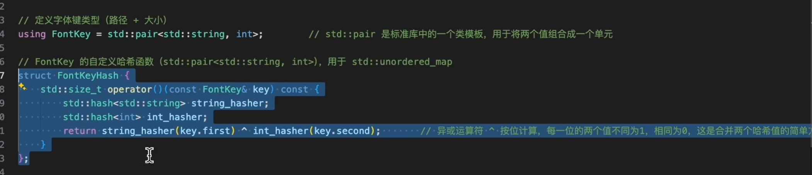
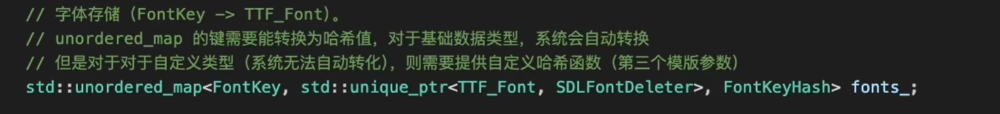
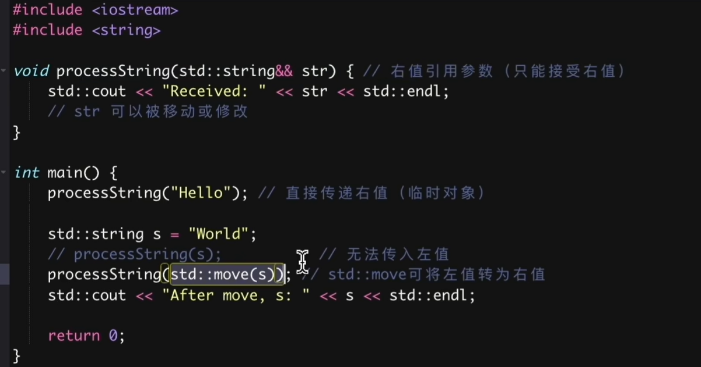
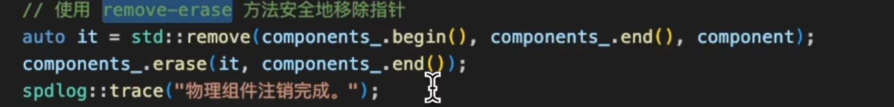

# 现代c++

- [现代c++](#现代c++)
    - [RULE OF FIVE原则](#RULE_OF_FIVE原则)
    - [RULE OF ZERO原则](#RULE_OF_ZERO原则)
    - [智能指针](#智能指针)
    - [explicit](#explicit)
    - [构建智能指针的删除函数](#构建智能指针的删除函数)
    - [map给予hash方法存hash值](#map给予hash方法存hash值)
    - [std::optional<>为数据类型定义了空类型](#std::optional<>为数据类型定义了空类型)
    - [std::variant,存储两个不同的类型，可用于map中不同数据类型一起纯粹，std::get<>(v)获取数据](#std::variant,存储两个不同的类型，可用于map中不同数据类型一起纯粹，std::get<>(v)获取数据)
    - [static_assert和std::is_base_of](#static_assert和std::is_base_of)
    - [std::type_index(typeid(T))](#stdtype_indextypeid(T))
    - [模版函数](#模版函数)
    - [std::forward完美转发,&&](#std::forward完美转发&&)
    - [右值引用](#右值引用)

## RULE_OF_FIVE原则
在一个类中显式声明了或自定义了一下五个特殊成员函数的任意一个，
那么通常需要考虑所有五个
- 析构函数
- 拷贝构造函数
- 移动构造函数
- 移动赋值函数

## RULE_OF_ZERO原则
该原则提倡类本身不应直接管理资源，而是通过RAIN工具类型管理资源，
也就是说C++不提倡使用裸指针而是使用其提供的智能指针来自动管理资源。

## 智能指针
- 在使用智能指针的时候，只在头文件向前应用类内的指针时，在cpp文件引入头文件，析构函数必须声明且在cpp文件实现，否则
  会生成内连的析构函数无法识别cpp里的头文件类内的智能指针不能正确销毁。

- 当类内的指针初始化是由其他类创建的指针赋值得到的，该类不用负责该指针的生命周期，指针谁创建谁负责

## explicit
在构造函数传参时，如果只有一个参数，要用explicit ，否则可能会隐式转化

## 构建智能指针的删除函数
SDL_Texture是c语言的代码的struct结构体，我们想要自动管理内存，需要给他一分哥析构的方法,当容器调用clear(),erase()等操作时都会自动释放内存，可以自动释放指针的内存，不用我们手动释放。
且每次插入的是std::unique_ptr<SDL_Texture,SDLTextureDeleter>
~~~cpp
//删除函数，用于智能指针管理
        struct SDLTextureDeleter {
            void operator()(SDL_Texture* texture) const {
                if (texture) {
                    SDL_DestroyTexture(texture);
                }
            }
        };

        std::unordered_map<std::string,std::unique_ptr<SDL_Texture,SDLTextureDeleter>> textures_;
~~~

## map给予hash方法存hash值

## std::optional<>为数据类型定义了空类型

## std::variant,存储两个不同的类型，可用于map中不同数据类型一起纯粹，std::get<>(v)获取数据

## static_assert和std::is_base_of
- static_assert(condition,message):静态断言，condition为假时输出mesage
- std::is_base_of<base,derived>::value:判断base是否是derived的基类

## std::type_index(typeid(T))
- typeid(T)获取T是什么类型
- std::type_index()转为类型标识符

## 模版函数

~~~cpp
void process(int x){}
void process(int x,int y){}

template<typename... Args>
void wrapper(Args... args){

    (process(args),...);
    
    process(args...);
}

int main(){
    int x = 42;
    wrapper(x,100);
}
~~~

### 可变参数的两种用法
- (process(args),...)：依次传入一个参数
- process(args...)：将所有参数同时传入，如果参数个数不匹配，就报错
- 上面的传参是拷贝，性能消耗高

### 左值与右值的区别

~~~cpp
void process(int x){}
void process(int x,int y){}

template<typename... Args>
void wrapper(Args&... args){

    (process(args),...);
    
    process(args...);
}

int main(){
    int x = 42;
    wrapper(x,100);
}
~~~

当wrapper函数按址传递时，由于main函数中传入的第二个参数100是右值，没有固定的地址，所以会报错

### std::forward完美转发,&&

~~~cpp
void process(int& x){}
void process(int&& x){}
void process(int& x,int&& y){}

template<typename... Args>
void wrapper(Args&&... args){

    (process(std::forward<Args>(args)),...);
    
    process(std::forward<Args>(args)...);
}

int main(){
    int x = 42;
    wrapper(x,100);
}
~~~
- 优点：性能好，避免左右值问题

## 右值引用

